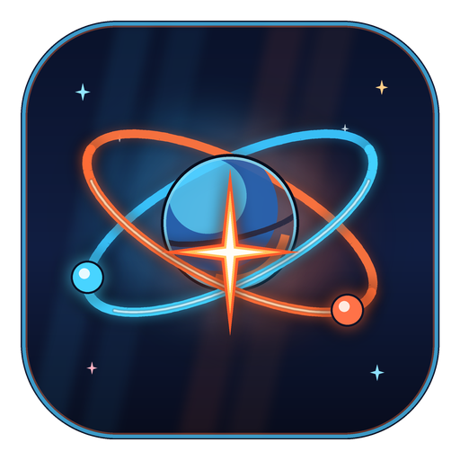
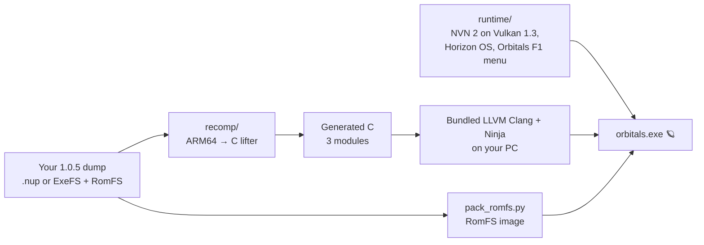

<div align="center">



# 🪐 SteelTemple Orbitals

### Orbitals, running natively on Windows PC

*A static recompilation of the Nintendo Switch 2 game, not an emulator.*

[](#-requirements)
[](#-under-the-hood)
[](#-quick-start)
[](https://github.com/STS78721/ORBIT/releases/tag/0.1.0)
[](#-credits--licence)

**[Quick start](#-quick-start)** · **[Features](#-highlights)** · **[Status](#-status-010-early-release)** · **[How it works](#-under-the-hood)** · **[Changelog](CHANGELOG.md)** · **[Credits](#-credits--licence)**

</div>

---

> [!WARNING]
> **Early Release (`0.1.0`):** *Orbitals* is booting and playable in 2-player local split-screen right now, but this is an **early release** — you may still encounter occasional rendering quirks, shader compilation stutters on first-seen areas, or performance dips across different GPU/CPU configurations. Updates will continue to polish visuals, stability, and frame rate.

> [!IMPORTANT]
> **No game files are included.** You need your own legally dumped copy of **Orbitals (1.0.5)** (either a `.nup` container or `ExeFS` and `RomFS` dump folders). This repository contains only the recompiler, runtime, launcher, and setup tools.

> [!NOTE]
> **Clean Zero-Config Defaults:** SteelTemple Orbitals launches on a safe, hardware-agnostic baseline (`1920x1080` windowed, Original internal resolution, Orbitals Station `F1` menu, `16x` anisotropic filtering, AMD FSR, Frame Generation Off, `60 FPS` limit) with no personal `.ini` settings bundled. Adjust resolution up to native `4K (2160p)`, fullscreen, upscaling, and controls anytime in **OrbitalsLauncher** or in-game (`F1`).

## ✨ Highlights

<table>
<tr>
<td width="50%" valign="top">

### 🚀 Native Windows PC binary, not emulation
Every ARM64 instruction across `main`, `subsdk0`, and `sdk` is translated **ahead of time** into C and compiled natively on your PC into `orbitals.exe`. No CPU interpreter runs while you play.

### 🖼️ Native 720p–4K UE5 resolution & clean fullscreen
Switch cleanly between **Original**, **720p**, **900p**, **1080p**, **1440p**, and **native 4K (2160p)** internal resolutions with per-monitor DPI awareness, borderless fullscreen (`F11` or `F1` menu), AMD FSR 1.0, and colour presets.

### ⚡ Vulkan 1.3 renderer, async replay & shader pre-warmer
Translates Switch 2 NVN 2 commands and Ampere (`SM86`) shaders to Vulkan 1.3 with asynchronous Vulkan command replay, UBO/descriptor/pipeline state memoisation, Graphics Pipeline Libraries, and a built-in `--warm-shaders` pre-warmer for smooth gameplay.

</td>
<td width="50%" valign="top">

### 🪐 Orbitals Station F1 menu
Press **F1** or **Esc** (or **Back + Y** on a controller) for a native settings overlay in the custom **Orbitals Station** theme (plus Dark and Light themes) with a live FPS / frametime pill (`F10`) and automatic saving to `orbitals.ini`.

### 🖥️ Setup Wizard & OrbitalsLauncher (.nup & direct dumps)
Install cleanly with **`SteelTemple-Orbitals-0.1.0-Full-Setup-Wizard.exe`** or the portable archive: bundled LLVM-MinGW, Ninja, and Python verify your **1.0.5** `.nup` container or `ExeFS`/`RomFS` folders, build `orbitals.exe` locally, and pre-warm shaders with no external tools required.

### 🎮 2-Player Local Co-Op controllers, mods & save backups
Built for **2-player local co-op** out of the box: connect any pair of **DualSense**, **Xbox**, **Switch / Switch 2 Pro**, or SDL-compatible controllers (USB or Bluetooth) for instant P1 + P2 split-screen play, plus timestamped save backups inside **OrbitalsLauncher**.

</td>
</tr>
</table>

## 📊 Status (`0.1.0` Early Release)

| Area | State |
|---|---|
| Boot, intro movies, title & menus | ✅ Working |
| 2-player local split-screen co-op gameplay | ✅ Playable (up to 60 fps target) |
| Native internal resolution (`original` – `2160p` 4K) & borderless fullscreen | ✅ Working |
| Multi-controller input (DualSense + Xbox + Switch Pro / SDL) | ✅ Working |
| Shader pre-warming (`--warm-shaders`) & async Vulkan replay | ✅ Working |
| Later chapters, edge-case visuals & performance across GPUs | ⚠️ Early release — rendering quirks and performance dips may still occur |
| Online play / GameShare | ❌ Not supported, by design |

## 🚀 Quick start

**1. Install SteelTemple Orbitals**

Download **`0.1.0`** from the **[Releases page](https://github.com/STS78721/ORBIT/releases/tag/0.1.0)**:
- Run **`SteelTemple-Orbitals-0.1.0-Full-Setup-Wizard.exe`** (no administrator rights required), or extract **`SteelTemple-Orbitals-0.1.0-Portable-StandAlone.zip`**.

**2. Set up from your Orbitals 1.0.5 dump**

Open **OrbitalsLauncher** → **SETUP FROM DUMP**, then choose one of:
- a **`.nup`** container (combined, or split base + `1.0.5` update in the same folder),
- a dump / NUP-extracted folder (flat `ExeFS` + `RomFS`, or `updates\<ver>\exefs`), or
- your **`ExeFS`** and **`RomFS`** folders directly.

Click **VERIFY & BUILD ORBITALS.EXE**. Setup verifies all 5 `1.0.5` ExeFS SHA-256 hashes, packs RomFS, lifts all 3 ARM64 modules to C, compiles `orbitals.exe` natively, and runs a short muted shader pre-warm pass.

**3. Play:** connect **two controllers** (Orbitals is a 2-player co-op game) and click **PLAY ORBITALS PC** (or run `orbitals.exe`).

<details>
<summary>Building from source (developers)</summary>

```bat
python tools\check_content.py
.venv\Scripts\python.exe recomp\gen.py --exefs "<dump>\exefs" --out generated\orbitals105 --patches recomp\patches-orbitals105.txt --modules main,subsdk0,sdk
.venv\Scripts\python.exe tools\pack_romfs.py --dir "<dump>\romfs" --out romfs_packed
.venv\Scripts\python.exe tools\build_game.py --version orbitals105 --expected tools\data\expected-orbitals105.json --gen generated\orbitals105 --exefs "<dump>\exefs" --romfs romfs_packed
.venv\Scripts\python.exe tools\build_orbitals_release.py
```

</details>

## 🖥️ Requirements

| | Minimum | Recommended |
|---|---|---|
| OS | Windows 10 64-bit | Windows 11 |
| CPU | x86-64 with AVX2 | 8 cores or more |
| GPU | Vulkan 1.3, 6 GB VRAM | NVIDIA RTX 30/40/50 or AMD RX 6000/7000, 8+ GB VRAM |
| RAM | 16 GB | 32 GB |
| Disk | ~20 GB free during setup | NVMe SSD |
| Controllers | 2 controllers (local co-op) | Any pair of DualSense, Xbox, Switch Pro, or SDL pads |

## ⚙️ Settings

Press **F1** / **Esc** in game or configure before launch inside **OrbitalsLauncher**. Settings save cleanly to `orbitals.ini` next to `orbitals.exe`, and any option can also be overridden with `ORBITALS_` / `NS2_` environment variables.

- **Fullscreen toggle:** press **F11** anytime or toggle **Fullscreen** in the `F1` menu.
- **Performance pill:** press **F10** anytime to cycle Off / FPS / Full telemetry.
- **Shader pre-warmer:** run `orbitals.exe --warm-shaders` anytime after updating your GPU driver to re-warm all recorded pipelines before playing.

## 🔧 Under the hood



- **CPU:** *Orbitals*' three ARM64 modules (`main`, `subsdk0`, `sdk`) are statically lifted to C ([`recomp/`](recomp/)); [`runtime/`](runtime/) supplies the Horizon OS kernel, load-order symbol resolution, H.264 decoding, memory management, audio, multi-controller HID input, and the Orbitals Station settings UI.
- **GPU:** Switch 2 NVN 2 commands translate onto **Vulkan 1.3** with Graphics Pipeline Libraries, Ampere (`SM86`) shader lowering, asynchronous Vulkan replay, incremental dynamic pipeline state diffing, UBO/descriptor memoisation, AMD FSR 1.0, and frame pacing.
- **Release Versioning:** [`VERSION`](VERSION) / [`launcher/orbitals_version.txt`](launcher/orbitals_version.txt) drive the version label across the Setup Wizard, `OrbitalsLauncher`, Windows Installed Apps, window title, `F1` menu, and `orbitals.exe`, alongside [`CHANGELOG.md`](CHANGELOG.md).

## 🙏 Credits & licence

Built with **Universal NS2 to PC**, **Eglantine** (Ampere SM86 shader lowering), **Ryujinx**, **SDL3**, **Dear ImGui**, **Vulkan Memory Allocator (VMA)**, **libopus**, **libvpx**, **dav1d**, **zstd**, and **FidelityFX FSR**.

Licensed under the **GNU GPL v3 or later** (see [`LICENSE`](LICENSE)); permissive and third-party notices are preserved in [`THIRD_PARTY_NOTICES.md`](THIRD_PARTY_NOTICES.md).

---

<div align="center">

<sub>Orbitals is developed by Shapefarm and published by Kepler Interactive. This is an unofficial non-commercial fan research project, not affiliated with or endorsed by Shapefarm, Kepler Interactive, or Nintendo. Please support the official release.</sub>

</div>
